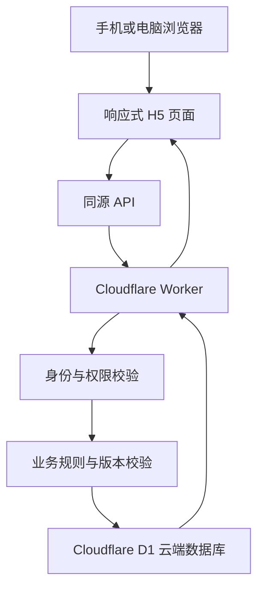

# 2027 尾牙积分竞技与竞标平台设计开发流程

更新日期为 2026 年 11 月 20 日。本文面向项目维护者和尾牙活动筹备人员，依据当前项目源码与本次开发、部署和验证记录编写。

线上入口为 [2027 尾牙积分平台](https://qingyu-login-portal.xphyym.chatgpt.site/)。

本地项目目录为 `D:\ai_workspace\sites\qingyu-login-portal`。

## 1. 项目目标与需求确认

平台用于真实尾牙活动，支持员工通过手机或电脑浏览器登录、查看积分、参与奖品竞标，并由关主和管理员登记积分、管理活动。产品采用响应式 H5 页面，服务端统一保存业务数据。

需求确认按以下顺序推进。

1. 查看参考网站 `https://hyc820.github.io/weiya-app/`，使用用户提供的 EMP001 查看登录后的页面。
2. 识别员工首页、积分、排行榜、竞标、公告、出价记录、得标结果、关主加分和管理后台。
3. 确认使用场景为真实尾牙、多人同时使用，采用云端数据存储和服务端权限校验。
4. 建立积分冻结、并发提交、重复加分和结标扣分的业务规则。
5. 完成私有部署与管理员初始化，再依据用户授权开放登录页。

参考网站用于确认功能范围。当前项目采用独立的视觉设计，业务数据保存于本项目的数据库。

## 2. 角色与权限设计

| 角色 | 登录后主要能力 |
| --- | --- |
| 员工 employee | 查看个人积分和明细、排行榜与公告，展示工号二维码，参与竞标，查看个人出价和得标结果 |
| 关主 gamemaster | 使用员工功能，按工号查询员工，登记签到和游戏加分 |
| 管理员 admin | 使用员工和关主功能，导入员工，新增奖品，提前结标，调整积分，发布公告，导出记录 |

前端根据角色显示菜单，服务端在每个受限操作中重新校验权限。

首位管理员的工号固定为 EMP001，姓名、部门和登录凭证通过初始化页面设置。初始化完成后，服务端拒绝再次初始化。

## 3. 页面与交互设计

页面采用深蓝主色、金色重点按钮、浅色背景和卡片布局。桌面端采用侧边导航，窄屏端切换为紧凑导航和适配手机的卡片排列。

| 页面 | 展示内容与主要交互 |
| --- | --- |
| 登录与初始化 | 初始化管理员，或使用工号与登录凭证登录 |
| 活动首页 | 员工身份、当前排名、积分概览、二维码入口、活动公告 |
| 我的积分 | 总积分、冻结积分、可用积分、积分流水 |
| 排行榜 | 员工总积分排名 |
| 竞标中心 | 奖品说明、数量、起标积分、开始与结束时间、提交或提高出价 |
| 我的出价 | 当前出价、竞标中状态、得标或未得标状态 |
| 得标结果 | 已结标奖品、得标员工与得标积分 |
| 活动公告 | 活动通知与流程说明 |
| 关主加分 | 手动输入工号、扫码查询、签到、游戏选择和加分档位 |
| 管理员后台 | 员工、奖品、公告和积分记录管理 |

业务页面使用 URL 哈希导航，例如 `#game` 和 `#auction`。登录状态由服务端会话维持。

界面使用表单标签、键盘焦点提示、错误提示和提交状态反馈。出价、积分调整和提前结标通过表单完成。

## 4. 系统架构



| 层次 | 当前实现 |
| --- | --- |
| 前端 | 原生 HTML、CSS、JavaScript |
| 服务端 | Cloudflare Worker ES Module |
| 数据库 | Cloudflare D1，通过 DB 绑定访问 |
| 本地验证数据库 | Node.js 内置 SQLite |
| 托管与发布 | Sites |
| 构建方式 | 将网页资源嵌入 Worker，生成可部署产物 |

数据库绑定记录在 `.openai/hosting.json`。当前绑定名为 `DB`，R2 配置为空。

## 5. 数据存储设计

当前数据库采用一张 `platform_state` 表保存平台状态。

| 字段 | 用途 |
| --- | --- |
| id | 固定为 1 的状态记录主键 |
| revision | 每次成功更新后递增的版本号 |
| payload | 保存业务对象的 JSON 文本 |

`payload` 包含以下数据。

| 数据项 | 保存内容 |
| --- | --- |
| employees | 工号、姓名、部门、角色、积分、盐值与凭证哈希 |
| products | 奖品名称、说明、数量、起标分、时间和结标状态 |
| bids | 出价员工、奖品、分数、提交时间、顺序和竞标结果 |
| ledger | 积分变动、原因、操作人、时间、签到或游戏标识 |
| notices | 活动公告 |
| sessions | 会话令牌哈希、员工工号和过期时间 |
| attempts | 登录失败次数与限制时间 |
| receipts | 请求编号、请求指纹、返回结果和过期时间 |
| bidSequence | 用于同时间出价排序的递增顺序号 |

数据库迁移定义位于 `drizzle/0000_platform.sql`，迁移登记位于 `drizzle/meta/_journal.json`。

新增结构时应追加迁移文件。已经应用的迁移需要保留，避免修改已部署数据库的历史。

## 6. 核心业务流程

### 6.1 员工登录

1. 员工输入工号和登录凭证。
2. 服务端将工号统一转换为大写并校验格式。
3. 服务端使用员工盐值计算凭证哈希，并与数据库记录比较。
4. 验证通过后生成随机会话令牌，数据库保存其哈希。
5. 浏览器通过 HttpOnly、Secure、SameSite=Strict Cookie 保存会话。
6. 后续请求由服务端解析会话并判断员工角色。

会话有效期为 12 小时。登录失败次数按来源地址累计，达到限制后进入等待期。凭证使用 PBKDF2-SHA-256 和随机盐值处理，迭代次数为 100000。

### 6.2 员工导入

1. 管理员新增单个员工，或选择 UTF-8 CSV 文件批量导入。
2. 必填列为工号、姓名、部门。
3. 可选列为角色和登录凭证。角色值为 employee、gamemaster 或 admin。
4. 服务端检查字段、角色、工号唯一性和凭证长度。
5. 未提供凭证的员工由系统生成随机凭证。
6. 整批校验成功后保存，任一记录失败则取消整批写入。
7. 前端提供新员工登录凭证 CSV 下载，由管理员分发给本人。

当前接口每批最多接受 1000 位员工。这个数量属于输入限制，现场导入耗时还需结合实际名单验证。

导入重试结果中的凭证使用当前会话令牌派生的密钥加密，以支持同一会话下的安全重试。

### 6.3 签到与游戏加分

1. 关主输入工号或扫描二维码查询员工。
2. 签到操作增加 100 分，同一员工只可登记一次。
3. 游戏包括套圈圈、飞镖、九宫格投球、神射手和趣味闯关。
4. 加分档位为 10、20、30、50、100 分。
5. 同一员工的同一游戏只可加分一次。
6. 成功后更新积分并写入流水，前端禁用已完成的游戏。

二维码仅编码员工工号。查询和加分仍须通过已登录的关主或管理员会话。

### 6.4 积分竞标

积分关系为 `可用积分 = 总积分 - 冻结积分`。

1. 服务端确认奖品存在、竞标已开始且尚未结束。
2. 出价必须为整数，并达到奖品起标分。
3. 员工提高已有出价时，新出价必须高于原出价。
4. 服务端核对可用积分，加上该奖品原先冻结的额度后判断是否足够。
5. 保存出价和新的出价时间、顺序号。
6. 该员工全部有效出价的合计值作为冻结积分。

当前规则允许提高出价。提高出价后，同价排序使用此次提高出价的提交时间与顺序。

### 6.5 结标与得标

1. 奖品到期后，在后续 API 请求中执行到期结算，管理员也可提前结标。
2. 有效出价按分数从高到低排序。
3. 同价时按出价时间排序，同时间再按提交顺序排序。
4. 按奖品数量选取得标记录，每人每种奖品最多得标一件。
5. 得标员工扣除其出价积分，并生成积分流水。
6. 其余出价标记为未得标，相关冻结额度释放。
7. 奖品标记为已结标，得标结果向登录员工展示。

当前到期处理由请求触发，尚未配置独立定时任务。无访问期间，到期后的结果会在下一次请求时落库。

## 7. API 与权限实现

| 接口 | 方法 | 用途 |
| --- | --- | --- |
| /api/status | GET | 查询是否需要初始化 |
| /api/setup | POST | 创建首位管理员 |
| /api/login | POST | 登录并创建会话 |
| /api/logout | POST | 注销当前会话 |
| /api/state | GET | 返回当前角色允许查看的数据 |
| /api/action | POST | 处理出价、加分、员工导入、奖品与公告等操作 |

`/api/action` 使用 action、data、requestId 三个字段。requestId 配合请求指纹识别重试，已成功的相同请求返回已保存结果，避免重复扣分或重复加分。

POST 请求检查同源 Origin、JSON 类型、请求体大小和字段内容。服务端还会根据员工角色限制操作，个人积分流水与出价数据按权限筛选返回。

## 8. 并发一致性设计

业务更新采用乐观并发控制。

1. 读取当前 revision 和 payload。
2. 在内存中执行权限、积分、状态和重复操作检查。
3. 通过 `WHERE id = 1 AND revision = ?` 提交新状态。
4. 更新成功后，版本号加一。
5. 如果版本已变化，则重新读取并重新执行业务检查。
6. 超出最多 20 次重试后，返回冲突提示。

该机制使积分变更、积分流水、出价状态与请求回执作为同一份状态提交，避免部分成功造成数据不一致。

当前所有业务数据集中在单条 JSON 状态中。随着员工、流水和出价数量增长，读取与更新成本会增加。较大规模活动需要根据实际人数、峰值操作量和数据大小验证容量，再评估拆分员工、出价、积分流水和会话表。

## 9. 目录与文件职责

```text
qingyu-login-portal/
├── .openai/hosting.json       站点标识与数据库绑定
├── web/
│   ├── index.html            网页入口
│   ├── style.css             响应式样式
│   ├── app.js                页面、表单与 API 交互
│   └── qr.js                 员工工号二维码生成
├── server/
│   ├── core.mjs              积分、竞标、结标与权限规则
│   ├── worker.mjs            API、会话、存储与资源响应
│   └── assets.mjs            构建生成的前端资源映射
├── drizzle/
│   ├── 0000_platform.sql     数据库初始迁移
│   └── meta/_journal.json    迁移登记
├── scripts/
│   ├── build.mjs             构建 Worker
│   └── preview.mjs           本地 HTTP 与 SQLite 预览
├── tests/
│   ├── platform.test.mjs     业务、权限、并发与二维码测试
│   └── qr-reference.json     标准二维码矩阵参考数据
├── dist/server/index.js      部署使用的 Worker 产物
├── outputs/                  本地预览数据与验证截图
└── package.json              构建与测试入口
```

## 10. 本地开发流程

项目使用 Node.js 24 运行构建、测试和本地 SQLite 预览。先在 PowerShell 中进入项目目录。

```powershell
Set-Location 'D:\ai_workspace\sites\qingyu-login-portal'
npm run build
npm test
node scripts/preview.mjs
```

本地预览地址为 `http://127.0.0.1:4173/`。

如果当前终端没有将 Node.js 加入 PATH，可使用开发时已验证的本机运行时路径。

```powershell
$taskNode = 'C:\Users\xphyy\.cache\codex-runtimes\codex-primary-runtime\dependencies\node\bin\node.exe'
& $taskNode scripts/build.mjs
& $taskNode --test tests/platform.test.mjs
& $taskNode scripts/preview.mjs
```

预览服务将数据写入 `outputs/preview.sqlite`。本地预览数据与云端 D1 数据分别保存。

修改前端文件或服务端源码后，需要重新构建并重启本地预览进程。开发时编辑 web 和 server 中的源文件，由构建脚本生成部署产物。

## 11. 测试与验收流程

### 11.1 自动化验证

已有测试覆盖以下关键场景。

- 管理员初始化、重复初始化拦截、错误凭证与正常登录。
- 员工越权操作拦截，退出后会话失效，同源请求校验。
- 重复签到与重复游戏加分的入账一致性。
- 同一员工并发出价时，冻结额度受可用积分限制。
- 结标扣分、释放冻结额度，以及重复结标拦截。
- 到期奖品在后续请求中结算，后续请求不会重复扣分。
- 批量员工导入失败时取消整批写入。
- 二维码矩阵与标准库生成结果一致。

### 11.2 浏览器验证

本次已在本地浏览器实际操作管理员登录、竞标出价、提前结标、得标结果、积分明细、关主查询、游戏加分和二维码展示，并查看页面错误日志。

出价验证使用 1000 分初始积分，提交 350 分出价后冻结 350 分，可用额度变为 650 分。结标后总积分变为 650 分，冻结额度归零，并生成一条 -350 分流水。

相关截图位于 `outputs/verified-home.jpg` 和 `outputs/verified-result.jpg`。云端初始化页截图位于 `outputs/cloud-setup.jpg`，该截图记录的是初始化前的界面。

### 11.3 并发验证

本地执行过 50 个同时提交的积分调整请求，50 个请求均成功，积分合计增加 50 分，耗时约 5.5 秒。该结果来自本机 HTTP 与 SQLite 预览环境，云端活动容量还需结合现场网络和真实业务混合负载验证。

### 11.4 现场验收

正式活动前应使用现场设备验证员工登录、关主手机相机权限、二维码识别、扫码枪输入、多人同时操作、网络中断后的提交重试，以及活动截止后的结果展示。

相机扫码目前依赖浏览器 BarcodeDetector 能力。浏览器不支持时，页面提供工号或扫码枪查询。现场手机相机识码尚待实机验收。

## 12. 云端部署与开放流程

1. 检查 `.openai/hosting.json`，继续使用现有站点 project_id。
2. 运行构建和测试，确认部署产物对应当前源代码。
3. 通过 Sites 源码工作流同步源代码，并生成部署归档。
4. 保存并部署对应源代码提交的站点版本。
5. 等待部署返回成功状态，检查数据库绑定和迁移表。
6. 打开线上页面，确认数据库访问和初始化流程。
7. 由用户设置管理员凭证并完成初始化。
8. 获得用户明确授权后，将登录页开放为公开访问。

截至本文更新时，已确认数据库 DB 中存在 platform_state 表，管理员初始化已完成，站点访问模式已设为 public。

任何持有网址的人均可打开登录页。员工业务功能由工号、登录凭证和服务端角色权限控制。

## 13. 活动筹备与数据维护

活动筹备人员可按以下顺序配置平台。

1. 管理员登录后导入员工名单，核对姓名、工号、部门和角色。
2. 下载并分发新员工登录凭证，安排关主账号。
3. 新增奖品，确认数量、起标分和竞标时间。
4. 发布正式活动流程、竞标规则与时间安排。
5. 使用现场手机和扫码设备完成验收。
6. 活动期间查看排行榜和积分流水，核对异常调整。
7. 活动结束后核对得标结果，导出员工积分和积分记录。

当前支持的 CSV 导出包括员工积分、积分记录，以及新导入员工的登录凭证。完整数据库备份、历史恢复和跨活动归档尚未实现为管理后台功能。

## 14. 当前实现边界与后续开发入口

| 项目 | 当前状态与后续工作 |
| --- | --- |
| 活动容量 | 已完成本地 50 并发请求验证，真实云端容量需结合参与人数继续验收 |
| 数据模型 | 当前为单条 JSON 状态，规模增长后可拆分数据表并优化查询 |
| 结标触发 | API 请求触发到期结算，若需要无人访问时准点落库，可增加定时任务 |
| 状态刷新 | 登录后页面约每15秒刷新业务状态，表单输入和弹窗期间暂停自动刷新 |
| 相机扫码 | 已实现能力检测与手动工号查询，需现场手机实测 |
| 游戏配置 | 游戏列表与分值档位目前写在源码中，调整规则需修改并重新部署 |
| 签到积分 | 当前固定100分，调整需修改服务端规则 |
| 账号维护 | 已实现初始化、登录和导入，凭证重置、账号停用与角色编辑尚待开发 |
| 活动数据 | 当前为单场活动的数据结构，多届尾牙隔离与归档尚待开发 |
| 数据备份 | 后台已有部分 CSV 导出，完整备份与恢复流程需另外建设 |

后续开发应沿用先确认业务规则、修改数据结构与服务端、补充对应验证、联调前端、现场验收、部署核对的顺序，确保积分和竞标结果保持一致。
